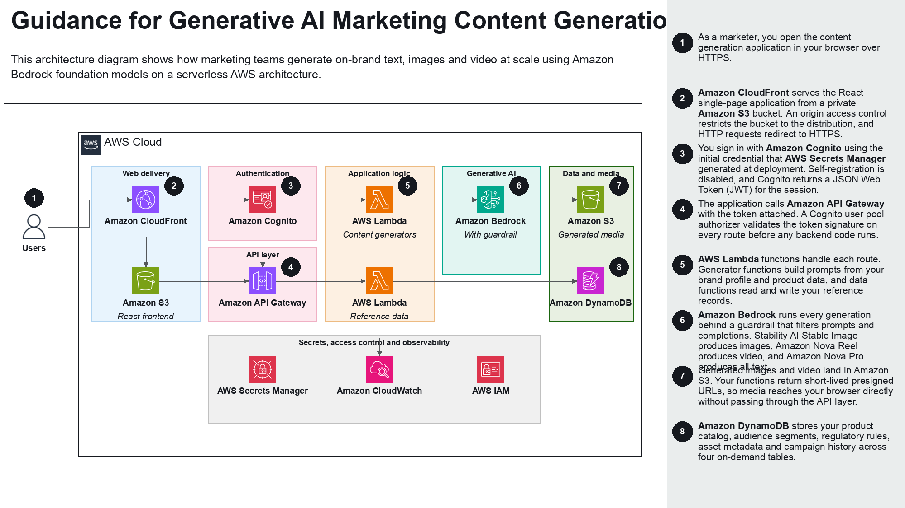

# Guidance for Generative AI Marketing Content Generation on AWS

This Guidance shows consumer packaged goods (CPG) and retail marketing teams how to generate on-brand marketing text, images, and video at scale using **Amazon Bedrock** foundation models on a serverless AWS architecture.

## Table of Contents

1. [Overview](#overview)
    - [Features](#features)
    - [Architecture overview](#architecture-overview)
    - [Architecture steps](#architecture-steps)
    - [AWS services in this Guidance](#aws-services-in-this-guidance)
    - [Cost](#cost)
2. [Prerequisites](#prerequisites)
    - [Operating System](#operating-system)
    - [Third-party tools](#third-party-tools)
    - [AWS account requirements](#aws-account-requirements)
    - [AWS CDK bootstrap](#aws-cdk-bootstrap)
    - [Service limits](#service-limits)
    - [Supported Regions](#supported-regions)
3. [Automated Deployment](#automated-deployment)
4. [Manual Deployment](#manual-deployment)
5. [Deployment Validation](#deployment-validation)
6. [Running the Guidance](#running-the-guidance)
7. [Next Steps](#next-steps)
8. [Cleanup](#cleanup)
9. [FAQ, known issues, additional considerations, and limitations](#faq-known-issues-additional-considerations-and-limitations)
10. [Revisions](#revisions)
11. [Notices](#notices)
12. [Authors](#authors)

## Overview

Marketing teams in consumer packaged goods (CPG) and retail produce thousands of content variants each quarter: product descriptions for every sales channel, social posts for every platform, packaging copy for every regulatory region, and localized versions for every market. Producing that volume by hand is slow, expensive, and drifts away from brand voice.

This Guidance solves that problem with a single serverless application that centralizes brand voice, product data, audience segments, and regulatory rules, then applies them consistently to every generation request. You store your brand guidelines once, and every text prompt automatically inherits them. You add products to a catalog once, and every generator can draw on them.

The Guidance deploys a **React** single-page application served through **Amazon CloudFront**, authenticated by **Amazon Cognito**, backed by **Amazon API Gateway** and **AWS Lambda**, and powered by **Amazon Bedrock** for all generative work. No servers, containers, or clusters to manage.

### Features

Eleven generators, each calling Amazon Bedrock:

| Generator | Amazon Bedrock model | Output |
| --- | --- | --- |
| Image | `us.stability.stable-image-style-guide-v1:0` | Up to 2 PNG images per request, returned as presigned URLs |
| Video | `amazon.nova-reel-v1:1` | 6-second 1280x720 MP4, generated asynchronously |
| Campaign | `us.amazon.nova-pro-v1:0` | Structured multi-channel campaign specification |
| Product description | `us.amazon.nova-pro-v1:0` | E-commerce, in-store, and social variants |
| Social media post | `us.amazon.nova-pro-v1:0` | Instagram, LinkedIn, X, Facebook, and TikTok variants |
| Email | `us.amazon.nova-pro-v1:0` | Subject line, preview text, body, and call to action |
| Packaging | `us.amazon.nova-pro-v1:0` | Label copy with region-appropriate regulatory disclaimers |
| Localization | `us.amazon.nova-pro-v1:0` | Culturally adapted translation plus adaptation notes |
| A/B variations | `us.amazon.nova-pro-v1:0` | Four tonal variants of one message |
| Trending topics | `us.amazon.nova-pro-v1:0` | Five to seven topic ideas with content angles |
| Performance insights | `us.amazon.nova-pro-v1:0` | Findings and prioritized recommendations |

Four data management areas, stored in **Amazon DynamoDB** and **Amazon Simple Storage Service (Amazon S3)**:

| Area | Purpose |
| --- | --- |
| Brand profile | Brand voice and guidelines, injected into every text prompt |
| Product catalog | Product records used as generation input |
| Audiences | Customer segment definitions |
| Regulatory rules | Per-region compliance copy used by the packaging generator |
| Asset library | Amazon S3 backed image and video storage with presigned upload and download |

### Architecture overview



*Figure 1: Reference architecture for Generative AI Marketing Content Generation on AWS.*

```
                    ┌─────────────────────┐
                    │  CloudFront + S3    │  ← static React SPA
                    └──────────┬──────────┘
                               │
                    ┌──────────▼──────────┐
                    │   API Gateway REST  │  ← Cognito JWT authorizer
                    └──────────┬──────────┘
                               │
   ┌───────────────────────────┼────────────────────────────┐
   │                           │                            │
┌──▼──────────┐    ┌───────────▼─────────┐    ┌─────────────▼─┐
│ Generator   │    │ Data Lambdas        │    │ Asset Lambda  │
│ Lambdas     │    │ - brand-profile     │    │ (presigned    │
│ - image-gen │    │ - product-catalog   │    │  uploads)     │
│ - video-gen │    │ - data-store        │    └────────┬──────┘
│ - text-gen  │    │   (audiences +      │             │
│ - campaign  │    │    regulatory)      │             │
└──┬──────────┘    └───────────┬─────────┘             │
   │                           │                       │
┌──▼─────────┐         ┌───────▼─────────┐    ┌────────▼──────┐
│  Bedrock   │         │   DynamoDB      │    │      S3       │
│ (Stability,│         │ (4 tables)      │    │ (6 buckets)   │
│ Nova Pro,  │         └─────────────────┘    └───────────────┘
│ Nova Reel) │
└────────────┘
```

### Architecture steps

1. A marketer opens the web application. **Amazon CloudFront** serves the static **React** single-page application from a private **Amazon Simple Storage Service (Amazon S3)** bucket over HTTPS, using an origin access control (OAC) so the bucket stays closed to the internet.
2. The marketer signs in with **Amazon Cognito**, using the initial credential that **AWS Secrets Manager** generated at deployment. Self-registration is disabled, and Amazon Cognito issues a JSON Web Token (JWT).
3. The application calls **Amazon API Gateway**, attaching the JWT. A request validator checks the request schema and the Amazon Cognito user pool authorizer validates the token signature before any request reaches a backend function.
4. **AWS Lambda** functions handle each route, each with its own execution role. Every function derives the caller's identity from the validated token and uses it to scope all data access.
5. Generator functions invoke **Amazon Bedrock** behind a guardrail that filters prompts and completions. Stability AI Stable Image produces images, Amazon Nova Reel produces video, and Amazon Nova Pro produces all text content.
6. **Amazon DynamoDB** stores products, audiences, regulatory rules, asset metadata, and campaign history across four on-demand tables, each partitioned by the caller's identity.
7. **Amazon S3** stores brand guidelines, generated images and video, and uploaded assets across private buckets, namespaced by caller. Functions hand the browser short-lived presigned URLs so media never transits Amazon API Gateway.
8. **Amazon CloudWatch Logs** captures function and API access logs with the caller identity on every request, and **AWS Identity and Access Management (IAM)** scopes each function's role to only the buckets, tables, and Amazon Bedrock models it uses.

### AWS services in this Guidance

| AWS service | Role in this Guidance |
| --- | --- |
| [Amazon Bedrock](https://aws.amazon.com/bedrock/) | Core. Runs all image, video, and text generation. A guardrail filters prompts and completions. |
| [AWS Lambda](https://aws.amazon.com/lambda/) | Core. Eight Python 3.13 functions implement every API route, plus a deploy-time credential provisioner. Each has its own execution role. |
| [Amazon API Gateway](https://aws.amazon.com/api-gateway/) | Core. REST API front door with an Amazon Cognito authorizer, request validation, throttling, and access logging. |
| [Amazon Cognito](https://aws.amazon.com/cognito/) | Core. User pool and app client for authentication. The `sub` claim is the tenant key. |
| [Amazon DynamoDB](https://aws.amazon.com/dynamodb/) | Core. Four on-demand tables partitioned by owner, with point-in-time recovery. |
| [Amazon S3](https://aws.amazon.com/s3/) | Core. Six buckets for site hosting, brand assets, generated media, uploads, and access logs. |
| [Amazon CloudFront](https://aws.amazon.com/cloudfront/) | Core. HTTPS content delivery, security response headers, and standard access logging. |
| [AWS Secrets Manager](https://aws.amazon.com/secrets-manager/) | Core. Generates and holds the initial admin credential so it never enters the stack template. |
| [AWS IAM](https://aws.amazon.com/iam/) | Supporting. One least-privilege execution role per function. |
| [Amazon CloudWatch](https://aws.amazon.com/cloudwatch/) | Supporting. Log capture with 90-day retention for all functions and the API stage. |
| [AWS CloudFormation](https://aws.amazon.com/cloudformation/) | Supporting. Provisions the stack through the AWS Cloud Development Kit (AWS CDK). |

### Cost

You are responsible for the cost of the AWS services used while running this Guidance. As of August 2026, the cost for running this Guidance with the default settings in the US East (N. Virginia) Region is approximately **$164.04 per month** for processing 5,000 text generations, 2,000 images, and 100 six-second videos.

Generative model inference dominates the bill at roughly 94 percent of the total. The serverless application layer, logging, and security controls together contribute under $11 per month at this volume. Costs scale almost linearly with generation volume, so a pilot that generates a tenth of this content costs roughly a tenth as much.

We recommend creating a [Budget](https://docs.aws.amazon.com/cost-management/latest/userguide/budgets-managing-costs.html) through [AWS Cost Explorer](https://aws.amazon.com/aws-cost-management/aws-cost-explorer/) to help manage costs. Prices are subject to change. For full details, refer to the pricing webpage for each AWS service used in this Guidance.

#### Sample cost table

The following table provides a sample cost breakdown for deploying this Guidance with the default parameters in the US East (N. Virginia) Region for one month.

| AWS service | Dimensions | Cost [USD] |
| --- | --- | --- |
| Amazon Bedrock (Stability AI Stable Image) | 2,000 images generated per month | $ 80.00 |
| Amazon Bedrock (Amazon Nova Reel) | 100 videos x 6 seconds = 600 video-seconds per month | $ 48.00 |
| Amazon Bedrock (Amazon Nova Pro) | 5,000 text generations: 7.5M input tokens, 5M output tokens | $ 22.00 |
| Amazon Bedrock Guardrails | 5,000 text units evaluated across content, topic, word, and sensitive information policies | $ 3.75 |
| Amazon DynamoDB | 10 GB storage, 50,000 on-demand request units, point-in-time recovery | $ 4.60 |
| AWS Lambda | 10,000 invocations, mixed 128-512 MB, avg 4s duration | $ 1.50 |
| Amazon S3 | 50 GB S3 Standard storage with versioning, 100,000 GET and 20,000 PUT requests, access logs | $ 1.70 |
| Amazon CloudWatch Logs | 2 GB ingested (function, API access, and CloudFront logs), 90-day retention | $ 1.10 |
| Amazon CloudFront | 10 GB data transfer out, 100,000 HTTPS requests, standard logging | $ 0.95 |
| Amazon API Gateway | 10,000 REST API calls per month | $ 0.04 |
| AWS Secrets Manager | 1 secret, under 1,000 API calls per month | $ 0.40 |
| Amazon Cognito | 100 monthly active users, Essentials feature plan | $ 0.00 |
| **Total** | | **$ 164.04** |

## Prerequisites

### Operating System

These deployment instructions are optimized to best work on **macOS**, **Amazon Linux 2023**, and other Linux distributions. On **Windows**, run the deployment from **Windows Subsystem for Linux (WSL)** or **Git Bash**; native PowerShell is not supported because the deployment script is a Bash script.

Install the following packages. Versions listed are the minimum tested versions.

| Package | Minimum version | Install command |
| --- | --- | --- |
| Node.js and npm | Node.js 18.x (Node.js 20.x recommended) | macOS: `brew install node@20` <br> Amazon Linux 2023: `sudo dnf install -y nodejs20` <br> Or download from [nodejs.org](https://nodejs.org/en/download) |
| AWS Command Line Interface (AWS CLI) | v2 | Follow the [AWS CLI install guide](https://docs.aws.amazon.com/cli/latest/userguide/getting-started-install.html) |
| AWS Cloud Development Kit (AWS CDK) | 2.x | `npm install -g aws-cdk@2` |
| Git | 2.x | macOS: `brew install git` <br> Amazon Linux 2023: `sudo dnf install -y git` |

Verify the toolchain:

```bash
node --version    # expect v18.x or higher
npm --version
aws --version     # expect aws-cli/2.x
cdk --version     # expect 2.x
```

### Third-party tools

No third-party tools are required. All model inference runs on Amazon Bedrock inside your AWS account.

### AWS account requirements

- An AWS account with permission to create Amazon S3 buckets, Amazon CloudFront distributions, Amazon Cognito user pools, Amazon API Gateway REST APIs, AWS Lambda functions, Amazon DynamoDB tables, and AWS IAM roles.
- Configured AWS credentials. Run `aws configure`, or export `AWS_PROFILE` for a named profile.
- **Amazon Bedrock model access** enabled in your deployment Region for all three models:
  - `stability.stable-image-style-guide-v1:0`
  - `amazon.nova-pro-v1:0`
  - `amazon.nova-reel-v1:1`

  Enable access in the [Amazon Bedrock console](https://console.aws.amazon.com/bedrock/) under **Model access** > **Modify model access**. Some accounts have these models enabled by default. Without model access, the stack deploys successfully but every generation request returns an error.

No Amazon Route 53 hosted zone, AWS Certificate Manager (ACM) certificate, or Amazon Virtual Private Cloud (Amazon VPC) is required. Amazon CloudFront supplies the HTTPS certificate for its default domain name.

### AWS CDK bootstrap

This Guidance uses the AWS CDK. If you have not used the AWS CDK in your target account and Region before, bootstrap it once:

```bash
cdk bootstrap aws://<ACCOUNT-ID>/<REGION>
```

The automated deployment script detects whether the `CDKToolkit` stack already exists and bootstraps only when needed, so you can skip this step if you use `scripts/deploy.sh`.

### Service limits

Amazon Bedrock enforces per-model requests-per-minute and tokens-per-minute quotas that vary by account and Region. The image generator requests up to two images per call and the video generator uses asynchronous invocation, both of which keep this Guidance well inside default quotas for interactive use. If you drive the API from a batch process, request quota increases on the [Service Quotas](https://console.aws.amazon.com/servicequotas/) page for **Amazon Bedrock**.

The default AWS Lambda concurrent execution quota of 1,000 per Region is ample for interactive use.

### Supported Regions

Deploy this Guidance to a Region that offers all three Amazon Bedrock models. **US East (N. Virginia) (`us-east-1`)** is the default and the most thoroughly tested. **US West (Oregon) (`us-west-2`)** is also supported.

The Stability AI and Amazon Nova Pro model IDs used here are cross-Region inference profiles prefixed with `us.`, so they require a Region in the United States. Check the [Amazon Bedrock supported Regions documentation](https://docs.aws.amazon.com/bedrock/latest/userguide/models-regions.html) for current model availability before choosing a different Region.

## Automated Deployment

This section provides the quickest path to deploy the Guidance using an automated script.

For automated deployment, a one-click deploy script (`scripts/deploy.sh`) is available. This script automates all deployment steps including dependency installation, resource creation, and validation.

**Usage:**

```bash
# Clone the repository
git clone <repository-url>
cd rrcg-content-generation

# Make the script executable and run it
chmod +x scripts/deploy.sh
./scripts/deploy.sh
```

The script prompts you for the AWS Region only. You are never asked for a password: the initial admin credential is generated inside the stack by **AWS Secrets Manager** and retrieved after deployment.

To run non-interactively, set the Region up front:

```bash
export AWS_REGION=us-east-1
./scripts/deploy.sh
```

**What the script does:**

- Detects your platform (macOS, Linux, or Windows via WSL or Git Bash) and adjusts accordingly
- Verifies that the AWS CLI, Node.js 18+, npm, and valid AWS credentials are present
- Checks Amazon Bedrock model access in the target Region and warns about any missing models
- Installs frontend and AWS CDK dependencies, then builds the React application
- Bootstraps the AWS CDK if the `CDKToolkit` stack is absent
- Deploys the `ContentGenStack` AWS CloudFormation stack and writes outputs to `cdk-outputs.json`
- Validates the deployment: stack status, required outputs, the Amazon Cognito admin user, that the API rejects unauthenticated requests, and an HTTPS request to the Amazon CloudFront URL
- Prints the web application URL and the command that retrieves your admin credential

**Retrieve your admin credential** after deployment:

```bash
SECRET_NAME=$(aws cloudformation describe-stacks --region "$AWS_REGION" \
  --stack-name ContentGenStack \
  --query "Stacks[0].Outputs[?OutputKey=='AdminCredentialSecretName'].OutputValue" --output text)

aws secretsmanager get-secret-value --region "$AWS_REGION" \
  --secret-id "$SECRET_NAME" --query SecretString --output text
```

The credential exists only in AWS Secrets Manager. It is not in the AWS CloudFormation template, not in `cdk.out/`, and not in any log. Rotate it after first sign-in.

**Environment:**

- Runs on macOS, Amazon Linux 2023, other Linux distributions, and Windows through WSL or Git Bash
- Runs unattended in AWS CodeBuild with no credential handling required
- Requires the AWS CLI configured with appropriate credentials

A cold deployment takes about 6 minutes, most of it Amazon CloudFront distribution creation. Subsequent deployments take 30 to 60 seconds.

**Note:** For a detailed understanding of each deployment step, see the [Manual Deployment](#manual-deployment) section below.

## Manual Deployment

Use these steps if you want to understand each step in detail or customize the deployment process.

1. Clone the repository.

   ```bash
   git clone <repository-url>
   cd rrcg-content-generation
   ```

2. Confirm your AWS identity and choose a Region.

   ```bash
   aws sts get-caller-identity
   export AWS_REGION=us-east-1
   export AWS_DEFAULT_REGION=us-east-1
   ```

   Note the `Account` value from the output. You need it for the AWS CDK environment variables in step 4.

3. Verify Amazon Bedrock model access in your chosen Region.

   ```bash
   aws bedrock list-foundation-models --region "$AWS_REGION" \
     --query "modelSummaries[?contains(modelId, 'nova') || contains(modelId, 'stable-image')].modelId" \
     --output table
   ```

   If `nova-pro`, `nova-reel`, or `stable-image` models are absent, enable them in the [Amazon Bedrock console](https://console.aws.amazon.com/bedrock/) under **Model access** > **Modify model access**, then re-run the command.

4. Export the AWS CDK environment variables. Replace `<ACCOUNT-ID>` with the account from step 2.

   ```bash
   export CDK_DEFAULT_ACCOUNT=<ACCOUNT-ID>
   export CDK_DEFAULT_REGION=us-east-1
   ```

   No credential is needed at deploy time. The stack creates an AWS Secrets Manager secret with a generated 24-character value and a provisioner function applies it to Amazon Cognito, so no credential material passes through your shell, your environment, or the AWS CloudFormation template.

5. Install the frontend dependencies and build the React application. The AWS CDK stack uploads the `dist/` directory to Amazon S3, so this step must run before deployment.

   ```bash
   npm install
   npm run build
   ls dist    # expect index.html and an assets/ directory
   ```

6. Install the AWS CDK project dependencies.

   ```bash
   cd cdk
   npm install
   ```

7. Bootstrap the AWS CDK in the target account and Region. Skip this step if the `CDKToolkit` stack already exists.

   ```bash
   npx cdk bootstrap "aws://$CDK_DEFAULT_ACCOUNT/$CDK_DEFAULT_REGION"
   ```

8. Review the changes the AWS CDK plans to make, then deploy the stack.

   ```bash
   npx cdk diff
   npx cdk deploy --require-approval never --outputs-file ../cdk-outputs.json
   ```

9. Capture the deployed resource identifiers from the stack outputs.

   ```bash
   cd ..
   aws cloudformation describe-stacks --region "$AWS_REGION" \
     --stack-name ContentGenStack \
     --query "Stacks[0].Outputs" --output table
   ```

   Record the outputs: `WebsiteUrl` is the application URL, `ApiUrl` is the Amazon API Gateway endpoint, `UserPoolId` and `UserPoolClientId` identify the Amazon Cognito resources, and `AdminCredentialSecretName` names the AWS Secrets Manager secret holding your generated admin credential. The stack writes the first four values to `config.json` in the website bucket, so the frontend picks them up automatically at runtime. The credential is never written to `config.json`.

10. Retrieve the generated admin credential.

    ```bash
    aws secretsmanager get-secret-value --region "$AWS_REGION" \
      --secret-id "$(aws cloudformation describe-stacks --region "$AWS_REGION" \
        --stack-name ContentGenStack \
        --query "Stacks[0].Outputs[?OutputKey=='AdminCredentialSecretName'].OutputValue" \
        --output text)" \
      --query SecretString --output text
    ```

## Deployment Validation

Work through these checks in order. Each one confirms a different layer of the Guidance.

1. Confirm the AWS CloudFormation stack reached a healthy state.

   ```bash
   aws cloudformation describe-stacks --region "$AWS_REGION" \
     --stack-name ContentGenStack \
     --query "Stacks[0].StackStatus" --output text
   ```

   Expected output: `CREATE_COMPLETE` on a first deployment, or `UPDATE_COMPLETE` on a redeployment. Alternatively, open the [AWS CloudFormation console](https://console.aws.amazon.com/cloudformation/) and verify that the stack named `ContentGenStack` shows a green **CREATE_COMPLETE** status.

2. Confirm every AWS Lambda function in the stack is active. This includes the eight API handlers, the deploy-time admin provisioner, and the AWS CDK custom-resource framework function.

   ```bash
   for fn in $(aws cloudformation describe-stack-resources --region "$AWS_REGION" \
       --stack-name ContentGenStack \
       --query "StackResources[?ResourceType=='AWS::Lambda::Function'].PhysicalResourceId" \
       --output text); do
     echo "$fn: $(aws lambda get-function-configuration --region "$AWS_REGION" \
       --function-name "$fn" --query State --output text)"
   done
   ```

   Expected output: every function reports `Active`.

3. Confirm all four Amazon DynamoDB tables are available.

   ```bash
   for tbl in $(aws cloudformation describe-stack-resources --region "$AWS_REGION" \
       --stack-name ContentGenStack \
       --query "StackResources[?ResourceType=='AWS::DynamoDB::Table'].PhysicalResourceId" \
       --output text); do
     echo "$tbl: $(aws dynamodb describe-table --region "$AWS_REGION" \
       --table-name "$tbl" --query Table.TableStatus --output text)"
   done
   ```

   Expected output: every table reports `ACTIVE`.

4. Confirm the Amazon Cognito admin user exists and is ready to sign in.

   ```bash
   USER_POOL_ID=$(aws cloudformation describe-stacks --region "$AWS_REGION" \
     --stack-name ContentGenStack \
     --query "Stacks[0].Outputs[?OutputKey=='UserPoolId'].OutputValue" --output text)

   aws cognito-idp admin-get-user --region "$AWS_REGION" \
     --user-pool-id "$USER_POOL_ID" --username admin \
     --query UserStatus --output text
   ```

   Expected output: `CONFIRMED`.

5. Confirm Amazon API Gateway rejects unauthenticated requests. This verifies the Amazon Cognito authorizer is enforcing.

   ```bash
   API_URL=$(aws cloudformation describe-stacks --region "$AWS_REGION" \
     --stack-name ContentGenStack \
     --query "Stacks[0].Outputs[?OutputKey=='ApiUrl'].OutputValue" --output text)

   curl -s -o /dev/null -w "%{http_code}\n" -X POST \
     -H 'Content-Type: application/json' \
     -d '{"content_type":"email","input":"test"}' \
     "${API_URL}generate-text"
   ```

   Expected output: `401`. A `200` here means the authorizer is not attached and you should stop and investigate.

6. Confirm Amazon CloudFront serves the application and its runtime configuration.

   ```bash
   WEBSITE_URL=$(aws cloudformation describe-stacks --region "$AWS_REGION" \
     --stack-name ContentGenStack \
     --query "Stacks[0].Outputs[?OutputKey=='WebsiteUrl'].OutputValue" --output text)

   curl -s -o /dev/null -w "site: %{http_code}\n" "$WEBSITE_URL"
   curl -s "$WEBSITE_URL/config.json"
   ```

   Expected output: `site: 200`, followed by a JSON document containing `apiUrl`, `region`, `userPoolId`, and `userPoolClientId`. If you see a non-200 status immediately after deployment, wait two to three minutes for the Amazon CloudFront distribution to finish propagating and retry.

## Running the Guidance

### Guidance inputs

| Input | Where you provide it | Example |
| --- | --- | --- |
| Sign-in credentials | Application sign-in page | Username `admin` and the credential you set at deployment |
| Brand profile | **Brand Profile** page | Brand voice, tone, and guideline text |
| Product record | **Product Catalog** page | Name, category, ingredients, claims |
| Generation prompt | Any generator page | Free-text description of the content you want |

### Steps to run

1. Open the `WebsiteUrl` from the stack outputs in a browser.

   ```bash
   aws cloudformation describe-stacks --region "$AWS_REGION" \
     --stack-name ContentGenStack \
     --query "Stacks[0].Outputs[?OutputKey=='WebsiteUrl'].OutputValue" --output text
   ```

2. Sign in with username `admin` and the credential you supplied during deployment.

3. Open **Brand Profile** and save your brand guidelines. Use this sample text to try it out:

   ```text
   Brand: Northwind Naturals
   Voice: warm, plain-spoken, quietly confident. Never hype.
   Always: lead with the ingredient story, name the farm region.
   Never: superlatives, medical claims, exclamation points.
   Audience: households aged 28-45 who read labels.
   ```

   Every text generator now inherits this context automatically. This is the highest-leverage step in the application, so do it before generating anything else.

4. Open **Product Catalog** and add a product:

   | Field | Value |
   | --- | --- |
   | Name | Northwind Cold-Pressed Oat Milk |
   | Category | Plant-based beverages |
   | Description | Whole-grain oats from the Palouse, pressed cold, three ingredients |

5. Open **Product Description** and enter the prompt below, then choose **Generate**:

   ```text
   Northwind Cold-Pressed Oat Milk, 32 oz carton, launching in natural grocery.
   Emphasize the three-ingredient formula and Palouse sourcing.
   ```

6. Try the other generators with the same product. **Social Media** produces platform-specific posts, **Email** produces a full campaign, **Packaging** produces label copy with regulatory disclaimers, **Localization** adapts copy for another market, and **A/B Variations** produces four tonal variants.

7. Open **Image Generator** and enter a visual prompt, for example:

   ```text
   A 32 oz carton of oat milk on a weathered wooden table, soft morning light
   from the left, wheat field softly blurred in the background, editorial style
   ```

   Image generation runs asynchronously. The page polls for completion and then displays the results.

8. Open **Video Generator** for a 6-second 1280x720 clip. Nova Reel is asynchronous and typically takes two to four minutes.

### Expected output

| Generator | What you get back |
| --- | --- |
| Product description | JSON with `ecommerce` (150-200 words), `retail` (50-75 words), and `social` (30-50 words with hashtags) |
| Social media post | JSON keyed by platform: `instagram`, `linkedin`, `twitter`, `facebook`, `tiktok` |
| Email | JSON with `subject`, `preview_text`, `body` in markdown, and `cta` |
| Packaging | JSON with `headline`, `tagline`, `benefits`, `ingredients_statement`, `regulatory_disclaimers`, and `usage_instructions` |
| Localization | JSON with `translated` content and an array of cultural adaptation `notes` |
| A/B variations | JSON with four `variations`, each carrying a `tone` and `text` |
| Image | Up to two PNG images, delivered as presigned Amazon S3 URLs valid for one hour |
| Video | One MP4, delivered as a presigned Amazon S3 URL |

### Interpreting the output

Read the generated copy against your brand profile first. If the tone is off, refine the brand profile text rather than the individual prompt: the profile applies to every generator, so one edit improves all of them.

Treat every output as a first draft that needs human review. Packaging and regulatory copy in particular requires sign-off from your regulatory team before it reaches a label. Foundation models can produce plausible but incorrect claims, and this Guidance does not validate claims against any authoritative source.

Generated media is delivered through presigned URLs that expire after one hour. Download anything you want to keep, or copy it into the **Asset Library** for durable storage.

## Next Steps

Extend this Guidance in the following directions:

- **Swap in different foundation models.** The video function reads its model identifier from the `BEDROCK_MODEL` environment variable in `cdk/lib/cdk-stack.ts`. Image and text model identifiers are constants at the top of `image_gen.py` and `text_gen.py`. The AWS Identity and Access Management (IAM) grants are built from the `FOUNDATION_MODELS` and `INFERENCE_PROFILES` arrays at the top of `cdk/lib/cdk-stack.ts`, so add any new model identifier there as well.
- **Require multi-factor authentication.** The Amazon Cognito user pool enforces a 12-character password policy but does not require MFA. Set `mfa: cognito.Mfa.REQUIRED` with time-based one-time password (TOTP) as the second factor. This also requires moving the browser client from the `USER_PASSWORD_AUTH` flow to the Amazon Cognito hosted UI with authorization code plus Proof Key for Code Exchange (PKCE), so that it can handle the MFA challenge.
- **Enable Amazon Cognito threat protection.** Turn on the Plus feature plan for compromised-credential detection and adaptive authentication. This carries a per-monthly-active-user charge, which is why it is not enabled by default in this Guidance.
- **Add customer-managed encryption keys.** All storage is encrypted with AWS managed keys. Switch the buckets to `BucketEncryption.KMS` and the tables to `TableEncryption.CUSTOMER_MANAGED` with an AWS Key Management Service (AWS KMS) customer-managed key if you need encryption to act as an access control with its own key policy.
- **Add Amazon VPC isolation.** The functions run outside an Amazon Virtual Private Cloud (Amazon VPC) with unrestricted outbound access. Place them in private subnets with interface endpoints for Amazon Bedrock and gateway endpoints for Amazon S3 and Amazon DynamoDB, then attach a security group that permits no general egress.
- **Retain data on stack deletion.** Every stateful resource uses `RemovalPolicy.DESTROY` with `autoDeleteObjects` so the sample uninstalls cleanly. Switch to `RemovalPolicy.RETAIN` and `autoDeleteObjects: false` before storing anything you care about, and enable MFA delete on the asset bucket.
- **Deploy to a second Region.** This Guidance is single-Region. Add cross-Region replication on the asset and brand buckets, convert the tables to Amazon DynamoDB global tables, and front the application with Amazon Route 53 health-check failover.
- **Replace the asynchronous self-invoke with Amazon SQS.** The image generator self-invokes asynchronously. An Amazon Simple Queue Service queue with a Lambda event source mapping and a dead-letter queue would add automatic retries and failure capture.
- **Add Amazon CloudWatch alarms and AWS X-Ray tracing.** Set `tracing: Tracing.ACTIVE` on the functions and alarm on function errors, throttles, Amazon API Gateway 5XX responses, and Amazon Bedrock latency. Add an AWS Budgets action on Amazon Bedrock spend, which is the dominant cost line.
- **Use Amazon Cognito groups for role separation.** Data is already isolated per user. Add groups if you need shared team workspaces or a read-only reviewer role rather than strict per-user isolation.
- **Edit the prompt library and the guardrail.** The prompt templates live in the `PROMPTS` dictionary in `cdk/lib/lambda/text-gen/text_gen.py`. The denied topics, content filters, and personally identifiable information (PII) rules live in the `ContentGuardrail` construct in `cdk/lib/cdk-stack.ts`. Tune both to your category vocabulary and regulatory requirements.
- **Enable a custom domain name.** Add an AWS Certificate Manager (ACM) certificate and an Amazon Route 53 record to serve the application from your own domain. This also lets you raise the minimum Transport Layer Security (TLS) version above the TLSv1 floor imposed by the default Amazon CloudFront certificate.

## Cleanup

Deleting this Guidance removes every resource it created. Because the Amazon S3 buckets are configured with `autoDeleteObjects: true` and the Amazon DynamoDB tables use a `DESTROY` removal policy, **all generated images, videos, brand assets, uploaded files, product records, audiences, and regulatory rules are deleted permanently.** Export anything you want to keep before you proceed.

### Option 1: Use the deploy script

```bash
./scripts/deploy.sh --destroy
```

The script summarizes exactly what will be deleted and requires you to type `destroy` to confirm.

### Option 2: Use the AWS CDK directly

No environment variable is required for teardown.

```bash
cd cdk
npx cdk destroy
```

### Option 3: Use the AWS Management Console

Open the [AWS CloudFormation console](https://console.aws.amazon.com/cloudformation/), select the `ContentGenStack` stack, and choose **Delete**.

### Verify the teardown

```bash
aws cloudformation describe-stacks --region "$AWS_REGION" \
  --stack-name ContentGenStack 2>&1 | grep -q 'does not exist' \
  && echo "Stack deleted." \
  || echo "Stack still present. Check the AWS CloudFormation console."
```

### Manual deletion steps

The stack deletion handles bucket emptying automatically, but two items remain in your account:

1. **Amazon CloudWatch log groups.** AWS Lambda log groups are retained after stack deletion. Remove them to stop incurring storage charges:

   ```bash
   aws logs describe-log-groups --region "$AWS_REGION" \
     --log-group-name-prefix "/aws/lambda/ContentGenStack" \
     --query "logGroups[].logGroupName" --output text \
   | tr '\t' '\n' | while read -r lg; do
       [ -n "$lg" ] && aws logs delete-log-group --region "$AWS_REGION" --log-group-name "$lg"
     done
   ```

2. **The AWS CDK bootstrap stack.** The `CDKToolkit` stack and its staging bucket are shared across all AWS CDK projects in the account and Region. Leave it in place unless this Guidance was your only AWS CDK deployment.

## FAQ, known issues, additional considerations, and limitations

### Known issues

**Amazon Nova Reel model identifiers are flagged as legacy.** Both `amazon.nova-reel-v1:0` and `amazon.nova-reel-v1:1` appear as `LEGACY` in the Amazon Bedrock model catalog but remain callable on demand. The video function reads its model identifier from the `BEDROCK_MODEL` environment variable set in `cdk/lib/cdk-stack.ts`, so you can point it at a current model without changing function code.

**Generation fails with an access denied error.** This almost always means Amazon Bedrock model access is not enabled for that model in your Region. Enable it in the Amazon Bedrock console under **Model access**, then retry. No redeployment is needed.

**Presigned media URLs stop working after an hour.** Generated image and video URLs expire after 3,600 seconds by design. Reload the page to mint new URLs, or move the asset into the **Asset Library**.

**Amazon CloudFront returns a non-200 status right after deployment.** Distribution propagation takes a few minutes beyond stack completion. Wait two to three minutes and retry.

### Additional considerations

- **This Guidance creates one administrator account.** The AWS CDK stack provisions a single Amazon Cognito user named `admin` with a credential generated in AWS Secrets Manager. Self-signup is disabled. Create individual users in the Amazon Cognito console before letting a team use the deployment, and rotate the generated credential after first sign-in.
- **Data is isolated per user, not per team.** Every Amazon DynamoDB table is partitioned by the Amazon Cognito subject claim and every Amazon S3 object key is namespaced by it, so each signed-in user sees only their own brand profile, products, audiences, regulatory rules, and assets. There is no shared team workspace. If you need one, add Amazon Cognito groups as described in Next Steps.
- **Multi-factor authentication is not enabled.** The user pool enforces a 12-character password with mixed character classes, but a single credential is still sufficient to sign in. See Next Steps for enabling MFA.
- **Amazon DynamoDB tables and Amazon S3 buckets are destroyed with the stack.** Removal policies are set to `DESTROY` and `autoDeleteObjects` is enabled so the sample cleans up completely. Point-in-time recovery and bucket versioning are enabled, which protects against accidental writes and deletes but not against stack deletion. Change the removal policies to `RETAIN` if you keep data you care about.
- **The functions run outside an Amazon VPC.** All AWS Lambda functions have unrestricted outbound internet access with no security group or endpoint policy. See Next Steps for adding network isolation.
- **This Guidance is single-Region.** There is no cross-Region replication and no failover. A Regional service event takes the deployment offline.
- **Encryption uses AWS managed keys.** There is no customer-managed AWS KMS key, so encryption is not usable as an access control and there is no key policy to enforce separation of duty.
- **Generated content requires human review.** Foundation models can produce inaccurate claims. An Amazon Bedrock guardrail blocks medical and health claims, competitor disparagement, prompt attacks, profanity, and harmful content categories, and redacts personally identifiable information. A guardrail reduces risk but does not verify factual accuracy. Packaging, regulatory, and health-adjacent copy must still be reviewed by qualified personnel before publication.
- **Video output is capped at 6 seconds.** This reflects the Amazon Nova Reel text-to-video limit, not a limitation of this Guidance.
- **Asset uploads are restricted.** The presigned upload policy signs an allowlisted content type and a 100 MB maximum, both enforced by Amazon S3. Amazon Macie is not deployed, so uploaded files are not scanned for sensitive data.
- **All sample data in this Guidance is synthetic.** The brand, product, and audience examples are fictional and created for demonstration purposes.
- **Static analysis results.** The codebase is scanned with Automated Security Helper (ASH), covering static application security testing (SAST), software composition analysis (SCA), infrastructure as code (IaC), and secrets detection. Application code is clean under two independent SAST tools: Bandit reports zero findings across all Python files and Semgrep reports zero across the Python and JavaScript sources. detect-secrets and npm-audit both report zero. No suppressions and no baseline file are used. Checkov run against the synthesized AWS CloudFormation template with its full default policy set reports 63 remaining findings, every one of which maps to a documented limitation such as the absence of Amazon VPC isolation or the use of AWS managed keys rather than customer-managed keys. Those limitations are the ones listed in this section, and [Next Steps](#next-steps) describes how to close them for a production deployment.

For any feedback, questions, or suggestions, please use the issues tab under this repo.

### Local frontend development

After deploying once, you can run the frontend locally against the deployed backend. Pull the runtime values from the stack outputs rather than typing them by hand:

```bash
API_URL=$(aws cloudformation describe-stacks --region "$AWS_REGION" --stack-name ContentGenStack \
  --query "Stacks[0].Outputs[?OutputKey=='ApiUrl'].OutputValue" --output text)
USER_POOL_ID=$(aws cloudformation describe-stacks --region "$AWS_REGION" --stack-name ContentGenStack \
  --query "Stacks[0].Outputs[?OutputKey=='UserPoolId'].OutputValue" --output text)
CLIENT_ID=$(aws cloudformation describe-stacks --region "$AWS_REGION" --stack-name ContentGenStack \
  --query "Stacks[0].Outputs[?OutputKey=='UserPoolClientId'].OutputValue" --output text)

cat > .env <<EOF
VITE_API_URL=${API_URL}
VITE_REGION=${AWS_REGION}
VITE_USER_POOL_ID=${USER_POOL_ID}
VITE_USER_POOL_CLIENT_ID=${CLIENT_ID}
EOF

npm install
npm run dev
```

The `.env` file is excluded by `.gitignore`. Only the frontend runs locally; the deployed backend is reused.

### Project layout

```
├── src/                      # React frontend (Vite)
│   ├── pages/                # 16 feature pages
│   ├── components/
│   │   ├── Layout.jsx        # Sidebar and outlet
│   │   ├── TextGenerator.jsx # Shared by all text generation pages
│   │   └── DataManager.jsx   # Shared by the audiences and regulatory CRUD pages
│   ├── api.js                # fetch wrapper that injects the Cognito JWT
│   ├── auth.js               # Cognito InitiateAuth and token storage
│   └── config.js             # Loads /config.json injected by the CDK stack
├── cdk/
│   ├── bin/cdk.ts            # CDK app entrypoint
│   └── lib/
│       ├── cdk-stack.ts      # Full stack: Cognito, API Gateway, Lambda, S3, DynamoDB
│       └── lambda/           # Python functions, one per concern
│           ├── admin-user/   # Deploy-time provisioner, seeds the Cognito admin from Secrets Manager
│           ├── image-gen/
│           ├── video-gen/
│           ├── text-gen/     # All 8 text content types share this function
│           ├── campaign-gen/
│           ├── brand-profile/
│           ├── product-catalog/
│           ├── data-store/   # Audiences and regulatory rules share one function
│           ├── assets/
│           └── layers/common/ # Shared identity, CORS, guardrail, and error helpers
├── scripts/
│   └── deploy.sh             # One-click cross-platform deployment script
└── deploy.sh                 # Compatibility shim that calls scripts/deploy.sh
```

### Security posture summary

| Control | Implementation |
| --- | --- |
| Authentication | Amazon Cognito user pool, self-signup disabled, 12-character minimum with mixed character classes, 1-hour token validity |
| Authorization | The Amazon Cognito user pool authorizer validates JSON Web Token (JWT) signatures against the Cognito JSON Web Key Set (JWKS) on every one of the 20 API methods. Each handler then derives the tenant from the verified `sub` claim, never from the request body |
| Tenant isolation | Every Amazon DynamoDB table is partitioned by `owner` (the Cognito `sub`), so a caller can only Query their own partition. Every Amazon S3 object key is namespaced by the same value. No handler performs a table `Scan` |
| Secrets handling | The initial admin credential is generated by AWS Secrets Manager and applied to Amazon Cognito by a provisioner function that reads it by Amazon Resource Name (ARN) at deploy time. It never appears in the AWS CloudFormation template, in `cdk.out/`, or in any log. No credential exists in source control |
| Least privilege | Each of the AWS Lambda functions has its own execution role granting only the buckets, tables, and models it uses. Amazon Bedrock actions are scoped to the three specific foundation model and two inference profile ARNs. `lambda:InvokeFunction` is scoped to the single function that self-invokes |
| Input validation | Amazon API Gateway request models with a request validator reject malformed bodies, unknown fields, and prompts over 4,000 characters before any function runs. Handlers re-validate and reject caller input that would become a storage key |
| Generative AI safety | An Amazon Bedrock guardrail applies harmful-content filters, a prompt-attack filter, a profanity list, denied topics for medical claims and competitor disparagement, and PII redaction. The brand profile is passed to the model as delimited untrusted data rather than as system instructions |
| Encryption at rest | Amazon S3 server-side encryption with Amazon S3 managed keys (SSE-S3) on all buckets, AWS managed keys on all Amazon DynamoDB tables |
| Encryption in transit | `enforceSSL` on all buckets, HTTPS-only Amazon API Gateway, Amazon CloudFront redirects HTTP to HTTPS |
| Network exposure | All Amazon S3 buckets block all public access. The website bucket is reachable only through an Amazon CloudFront origin access control (OAC). Cross-origin resource sharing is restricted to the Amazon CloudFront domain on both the API and the media buckets |
| Browser hardening | An Amazon CloudFront response headers policy sends HTTP Strict Transport Security, `X-Content-Type-Options`, `X-Frame-Options: DENY`, and a referrer policy |
| Audit trail | Amazon API Gateway access logs record the caller `sub`, route, status, and latency for every request while deliberately excluding the `Authorization` header and request bodies. Amazon S3 server access logging and Amazon CloudFront standard logging both write to a dedicated log bucket. All log groups have a 90-day retention |
| Error handling | Handlers return a generic message plus a correlation identifier. The underlying exception is logged server-side only, so bucket names, table names, and account identifiers are never disclosed to callers |
| Abuse and cost control | Amazon API Gateway stage throttling at 50 requests per second with a 100 burst, reserved concurrency on the two long-running generators, and a signed 100 MB maximum on asset uploads |
| Data durability | Point-in-time recovery on all four tables, versioning on all four data buckets, and lifecycle rules that expire generated media and abandoned multipart uploads |

## Revisions

| Date | Version | Change |
| --- | --- | --- |
| August 2026 | 2.0 | Security hardening. Moved the initial admin credential to AWS Secrets Manager so it no longer appears in the AWS CloudFormation template. Added per-user data isolation: every Amazon DynamoDB table is partitioned by the Amazon Cognito subject claim and every Amazon S3 key is namespaced by it, replacing full-table scans with bounded queries. Split the shared AWS Lambda execution role into one role per function and scoped Amazon Bedrock permissions to specific model Amazon Resource Names. Added an Amazon Bedrock guardrail, Amazon API Gateway request validation and throttling, access logging across API Gateway, Amazon S3 and Amazon CloudFront, security response headers, point-in-time recovery, bucket versioning, and lifecycle rules on every bucket. Restricted cross-origin resource sharing to the Amazon CloudFront origin. Raised the password policy to 12 characters. Added a working ESLint configuration. |
| August 2026 | 1.0 | Initial release. Eleven generators, five data management areas, one-click deployment, and full Guidance documentation set. |

## Notices

*Customers are responsible for making their own independent assessment of the information in this Guidance. This Guidance: (a) is for informational purposes only, (b) represents AWS current product offerings and practices, which are subject to change without notice, and (c) does not create any commitments or assurances from AWS and its affiliates, suppliers or licensors. AWS products or services are provided "as is" without warranties, representations, or conditions of any kind, whether express or implied. AWS responsibilities and liabilities to its customers are controlled by AWS agreements, and this Guidance is not part of, nor does it modify, any agreement between AWS and its customers.*

## Authors

- Aamer Ahmed
- Emmanuel Ashiedu
- Padmaja Vedula

## License

This library is licensed under the MIT-0 License. See the [LICENSE](LICENSE) file.
